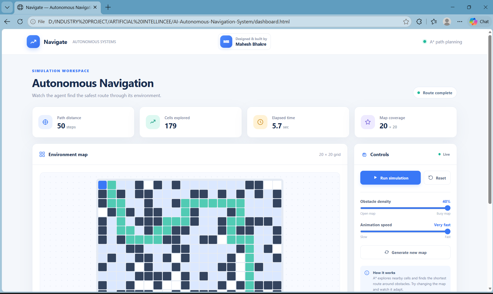
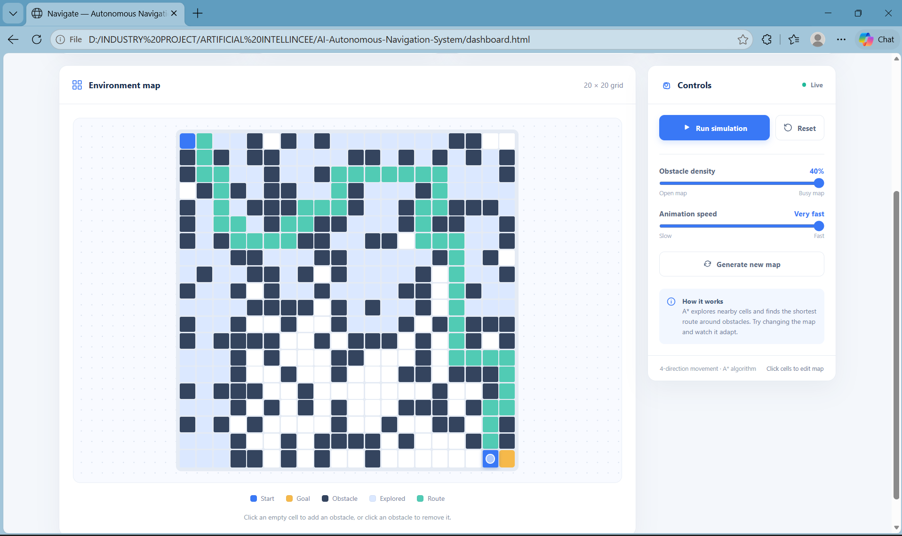
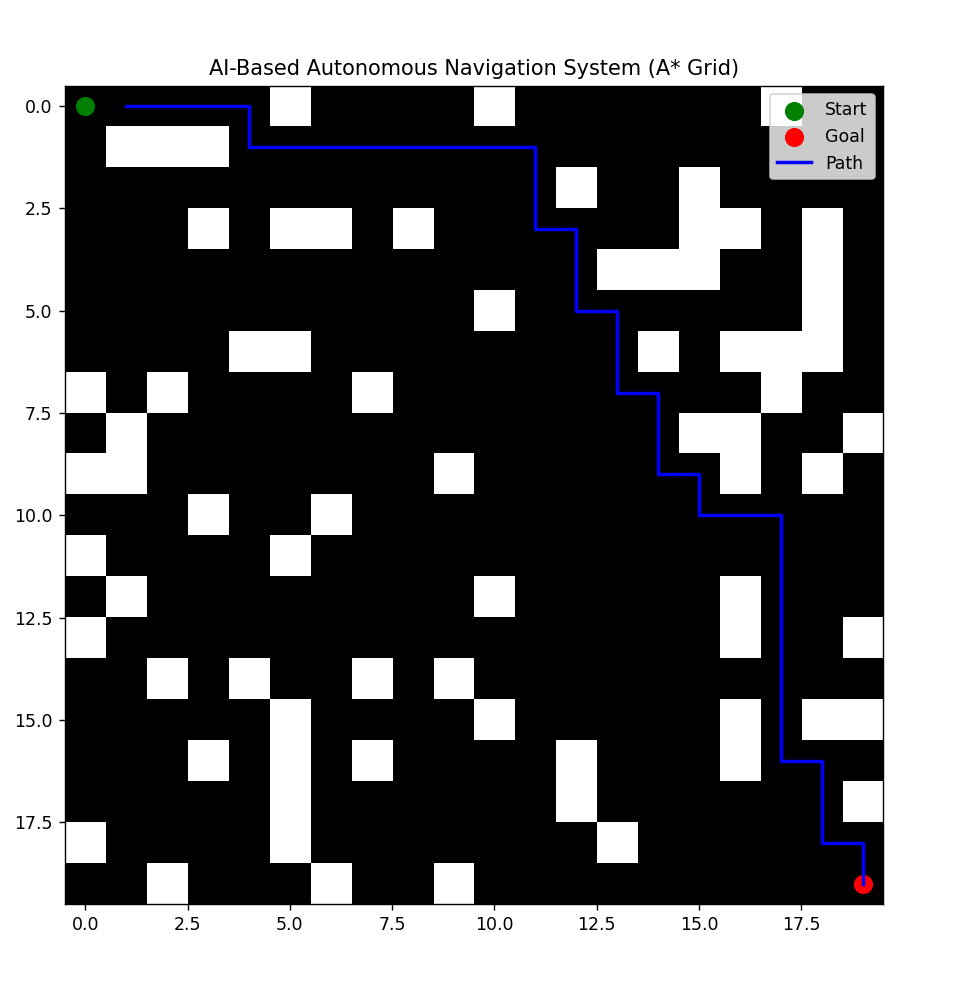
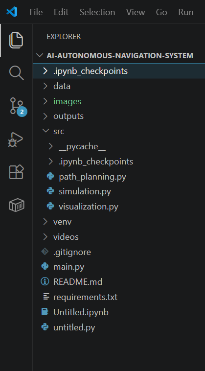

🧭 AI-BASED AUTONOMOUS NAVIGATION SYSTEM

[]
[]
[]
[]

---

## 🎬 PROJECT VIDEO

Watch the animated preview below, or open/download the full-resolution video:

<p align="center">
  <a href="videos/autonomous-navigation-demo.mp4">
    
  </a>
</p>

[▶️ Open or download the full demo video](videos/autonomous-navigation-demo.mp4)

## 🖼️ PROJECT PHOTOS

<p align="center">
  
</p>

<p align="center">
  
</p>

---

## ⚡ SYSTEM OVERVIEW
This project is an AI-based Autonomous Navigation System built using grid-based simulation and A* path planning algorithm.

It demonstrates how an intelligent agent can:
- Navigate from start to goal
- Avoid obstacles in a virtual environment
- Compute optimal path automatically

This simulates real-world autonomous systems used in robotics, drones, and self-driving vehicles.

---

## 🔥 PROBLEM STATEMENT
Traditional navigation systems are inefficient and not scalable.

This project solves:
- Optimal path finding problem
- Obstacle avoidance problem
- Autonomous decision-making in unknown environments

---

## 🏭 INDUSTRY RELEVANCE
This system is used in:
- Autonomous vehicles (Tesla, Waymo)
- Robotics navigation systems
- Warehouse automation (Amazon Robotics)
- Drone navigation systems

---

## 🧠 SYSTEM ARCHITECTURE

Grid Environment → Obstacle Generation → Start & Goal Setup → A* Path Planning → Optimal Path Computation → Visualization Engine → Final Navigation Output

---

## ⚙️ TECH STACK
Python, NumPy, Matplotlib, A* Path Planning Algorithm

---
```
## 📁 PROJECT STRUCTURE

AI-AUTONOMOUS-NAVIGATION-SYSTEM/
├── src/
│   ├── simulation.py
│   ├── path_planning.py
│   ├── visualization.py
│
├── main.py
├── dashboard.html
├── requirements.txt
├── README.md
├── videos/
│   ├── autonomous-navigation-demo.mp4
│   └── autonomous-navigation-preview.gif
├── ros2_ws/
│   └── src/autonomous_navigation/
│       ├── launch/navigation.launch.py
│       └── config/
├── images/
│   ├── Interface.png
│   └── output.png
```
---

## ⚙️ INSTALLATION

git clone https://github.com/maheshbhakre/AI-Autonomous-Navigation-System.git
cd AI-Autonomous-Navigation-System

python -m venv venv

venv\Scripts\activate   (Windows)
source venv/bin/activate   (Mac/Linux)

pip install -r requirements.txt

---

## ▶️ HOW TO RUN

python main.py

---

## 🖥️ INTERACTIVE DASHBOARD

Open `dashboard.html` in a modern web browser to use the interactive navigation dashboard. No additional packages, server, or build step are required.

The dashboard lets you:
- Watch A* explore the grid and animate the resulting shortest route
- Pause, resume, or reset a simulation
- Change the obstacle density and animation speed
- Generate a new map or click cells to add and remove obstacles
- View the route distance, explored cells, and elapsed time

The dashboard runs independently in the browser; `python main.py` remains available for the original Matplotlib simulation.

---

## 🤖 3D ROBOT SIMULATION (ROS 2 + GAZEBO)

For a robot simulation with a lidar, mapping, obstacle-aware navigation, and an A* planner, use the ROS 2 workspace in `ros2_ws/`. This runs a simulated TurtleBot3 Burger in Gazebo; it does not control a physical robot. The browser dashboard remains a separate grid demo.

### Requirements

- Windows 10/11 with WSL 2 and Ubuntu 24.04, or a native Ubuntu 24.04 machine
- ROS 2 Jazzy, Gazebo, and TurtleBot3 simulation packages

On Windows, install Ubuntu 24.04 with `wsl --install -d Ubuntu-24.04`, then run the remaining commands inside its Ubuntu terminal. Install the ROS 2 Jazzy desktop packages by following the [official ROS 2 Jazzy installation guide](https://docs.ros.org/en/jazzy/Installation/Ubuntu-Install-Debs.html), then install the simulation dependencies:

```bash
sudo apt update
sudo apt install -y ros-jazzy-navigation2 ros-jazzy-nav2-bringup \
  ros-jazzy-nav2-smac-planner ros-jazzy-dwb-critics ros-jazzy-slam-toolbox \
  ros-jazzy-turtlebot3 ros-jazzy-turtlebot3-gazebo \
  ros-jazzy-turtlebot3-teleop python3-colcon-common-extensions
```

### Build and run

In Ubuntu/WSL, change to the repository's `ros2_ws` directory (under `/mnt/d/...` for this Windows checkout), then build the workspace:

```bash
cd "/mnt/d/INDUSTRY PROJECT/ARTIFICIAL INTELLINCEE/AI-Autonomous-Navigation-System/ros2_ws"
source /opt/ros/jazzy/setup.bash
colcon build --symlink-install
source install/setup.bash
```

Open three Ubuntu terminals. In each terminal, change to the same `ros2_ws` directory, source ROS and the workspace, and select the Burger model:

```bash
cd "/mnt/d/INDUSTRY PROJECT/ARTIFICIAL INTELLINCEE/AI-Autonomous-Navigation-System/ros2_ws"
source /opt/ros/jazzy/setup.bash
source install/setup.bash
export TURTLEBOT3_MODEL=burger
```

Then run one command in each terminal:

1. Start the Gazebo world: `ros2 launch turtlebot3_gazebo turtlebot3_world.launch.py`
2. Start SLAM, Nav2's A* planner, and RViz: `ros2 launch autonomous_navigation navigation.launch.py`
3. Drive the robot around to map its surroundings: `ros2 run turtlebot3_teleop teleop_keyboard`

In RViz, select **2D Pose Estimate** and mark the robot's starting position and heading on the map. Drive around to let SLAM map the room, then select **Nav2 Goal** and click a destination. Nav2 plans an obstacle-aware route with its `SmacPlanner2D` A* planner; the local controller uses lidar data while driving. Save a completed map with `ros2 run nav2_map_server map_saver_cli -f ~/navigation_map`.

Stop the robot with `Ctrl+C` in the teleop terminal. This is a software simulation only: do not connect the simulated velocity commands to real motors without a separate hardware integration, emergency stop, and safety review.

---

## 🧪 SIMULATION WORKFLOW
1. Grid environment is generated  
2. Random obstacles are placed  
3. Start and goal positions are defined  
4. A* algorithm computes optimal path  
5. Visualization engine displays final output  

---

## 📸 RESULTS

<p align="center">

</p>

<p align="center">

</p>

<p align="center">

</p>

---

## 🚀 WHAT I LEARNED
- Path planning using A* algorithm  
- Grid-based simulation systems  
- Obstacle-aware navigation logic  
- Python visualization techniques  
- System design for autonomous agents  

---

## ⚠️ LIMITATIONS
- Static environment only  
- No real-time sensor integration  
- No dynamic obstacle handling  

---

## 🔮 FUTURE IMPROVEMENTS
- Real-time camera-based navigation  
- Dynamic obstacle avoidance  
- Reinforcement learning integration  
- ROS-based robotic implementation  
- CARLA simulator upgrade  

---

## 👨‍💻 AUTHOR
Mahesh Bhakre  

---

## 🌐 CONNECT WITH ME

<a href="https://github.com/maheshbhakre">

</a>

<a href="https://www.linkedin.com/in/maheshbhakreds1242">

</a>

<a href="https://www.instagram.com/mahesh_bhakre__2k06">

</a>

<a href="https://saimfsd.github.io/mahesh-portfolio/">

</a>

---

## ⭐ NOTE
This project demonstrates an AI-based autonomous navigation system using A* path planning in a virtual environment. It is designed for learning, internships, and placement-level portfolio demonstration.